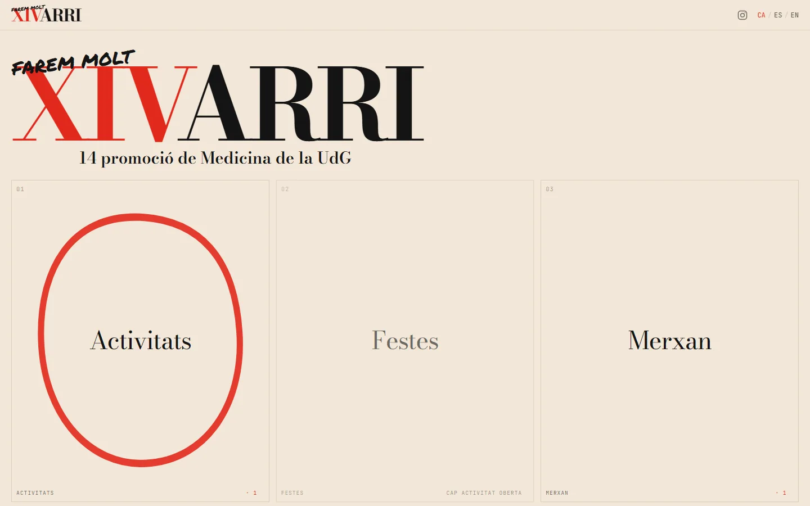
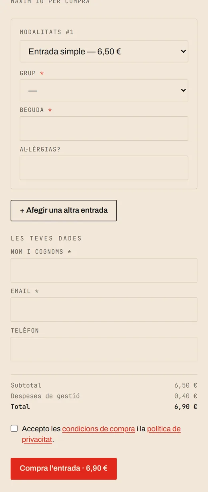
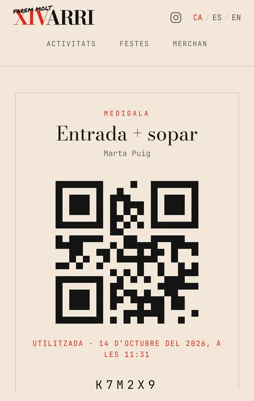
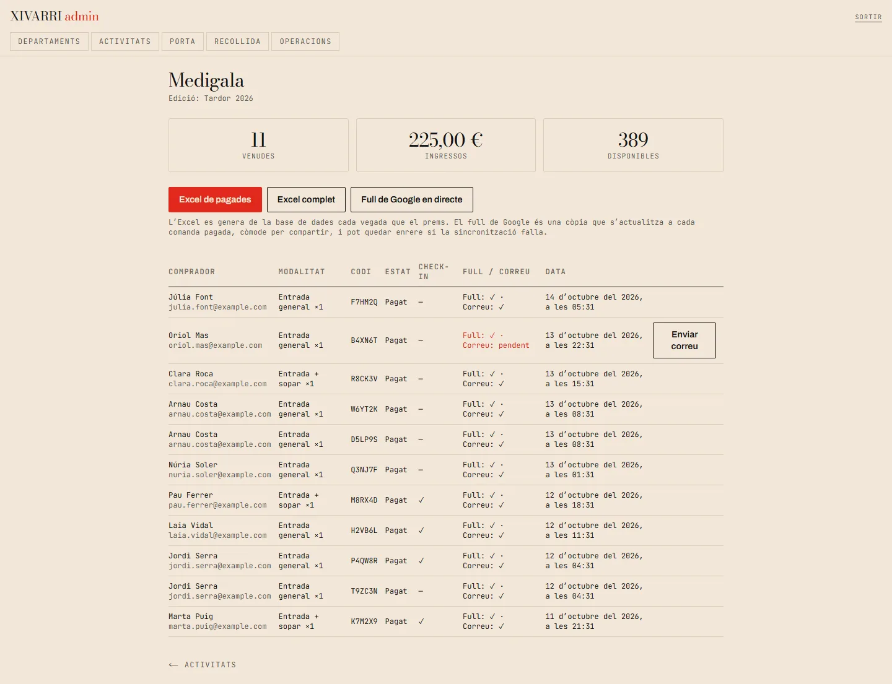
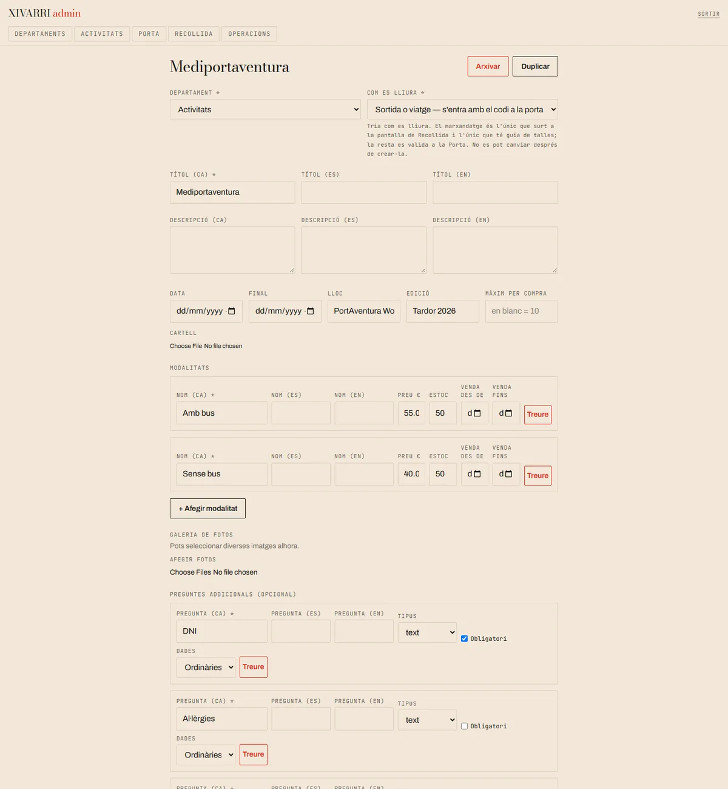
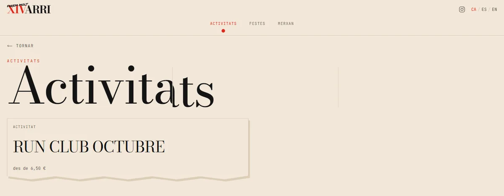
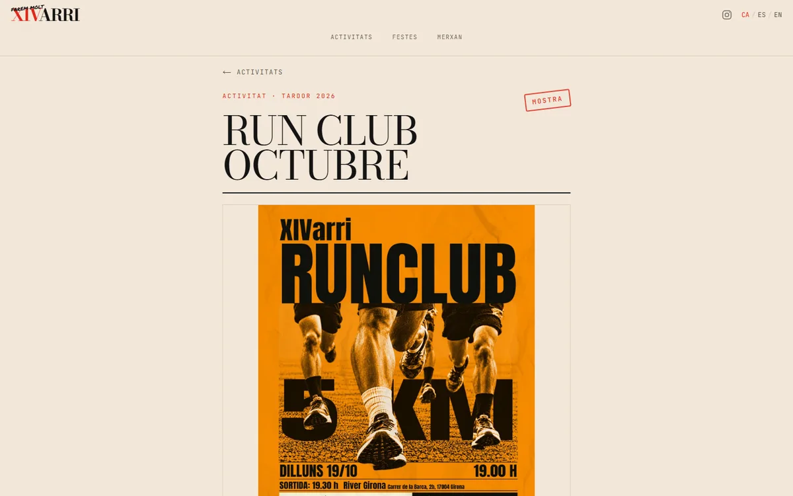
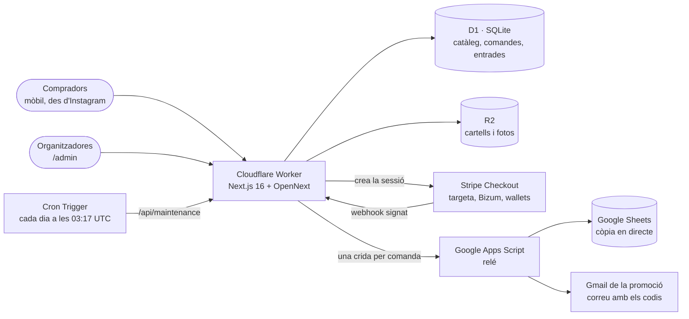
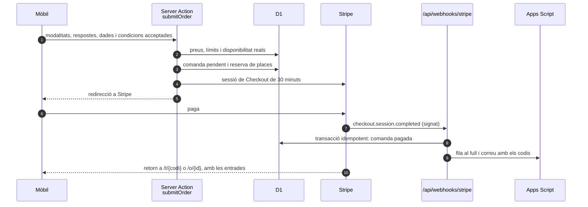
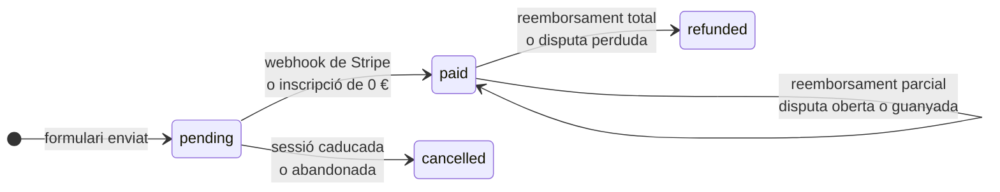

<div align="center">


# XIVARRI · entrades i activitats

**Venda d'entrades, viatges i marxandatge de la 14a promoció de Medicina de la Universitat de Girona, amb panell d'administració, control d'accés a la porta i full de Google en directe.**

[](https://xivarri.xivarri.workers.dev)

[](https://github.com/Barru23/Med_WebPage/actions/workflows/quality.yml)


</div>

> **English summary** — Production ticketing site for XIVARRI, the 14th medicine class at the University of Girona. Students arrive from an Instagram story on their phone and buy a party ticket, a trip seat or a hoodie in under a minute, with no account, paying by card, Apple/Google Pay or Bizum through Stripe Checkout. Every seat gets its own short code and QR at a URL, checked at the door from a phone. A non-technical organising team runs everything from five admin screens; each paid order is mirrored to a live Google Sheet and emailed from the class account through a single Apps Script relay. Built with Next.js 16, React 19 and TypeScript on Cloudflare Workers (D1 + R2) for €0/month.

> [!WARNING]
> El web en viu ven entrades reals i cobra diners reals. Per provar el flux de compra, fes-ho en local amb claus de prova de Stripe (vegeu [Posada en marxa local](#posada-en-marxa-local)).

<p align="center">
  
</p>

<table>
  <tr>
    <td width="25%"></td>
    <td width="25%"></td>
    <td width="25%"></td>
    <td width="25%"></td>
  </tr>
  <tr>
    <td align="center"><sub>1 · Arriba des d'Instagram</sub></td>
    <td align="center"><sub>2 · Compra sense compte</sub></td>
    <td align="center"><sub>3 · Entrada en una URL</sub></td>
    <td align="center"><sub>4 · Validada a la porta</sub></td>
  </tr>
</table>

## Què fa

Cada activitat de la promoció (festes, partits, curses, viatges, dessuadores…) té una pàgina pròpia amb el formulari de compra. Els enllaços de les històries d'Instagram porten directament a aquesta fitxa, amb el formulari obert: qui ja sap què vol no passa per la portada.

### Per a qui compra

- **Compra en menys d'un minut, sense compte.** Nom, correu, modalitat i, si l'activitat ho demana, preguntes pròpies (DNI, al·lèrgies, parada de bus…).
- **Pagament amb targeta, Apple Pay, Google Pay i Bizum** a Stripe Checkout. Les inscripcions de 0 € es confirmen a l'instant, sense passar per Stripe.
- **L'entrada viu en una URL**, `/t/{codi}`: un codi curt, sense caràcters que es confonguin (ni `0`/`O` ni `1`/`I`), prou gran per fer-ne una captura, amb el QR al costat. La porta funciona amb el codi; el QR és una comoditat.
- **Una entrada i un codi per plaça.** Qui compra tres places per a un viatge en rep tres, una per persona.
- **Correu de còpia** amb els codis, enviat des del compte de Gmail de la promoció.
- **Tres idiomes** (`/ca`, `/es`, `/en`), amb el català per defecte i com a reserva quan falta una traducció.

### Per a l'equip organitzador

L'equip no té formació tècnica, així que tot es fa des de formularis amb camps etiquetats, també des del mòbil. El panell té cinc pantalles i res més: qualsevol altra cosa és, a propòsit, una petició a desenvolupament.

| Pantalla | Què s'hi fa |
|---|---|
| **Departaments** | Nom en tres idiomes, fotografia i ordre. |
| **Activitats** | Crear, editar, duplicar, publicar i arxivar. Cartell, galeria, guia de talles, modalitats amb preu, estoc i finestra de venda, i preguntes pròpies. Edicions noves per a les activitats que es repeteixen. |
| **Vendes** | Venudes, ingressos i places disponibles per edició, llista de compradors, Excel generat al moment i enllaç al full de Google. |
| **Porta** | Escriure el codi o escanejar el QR, i veure un resultat gran en verd o vermell. També cerca per nom o correu, per a qui arriba sense el codi. |
| **Recollida** | Per al marxandatge: buscar un nom i marcar-lo com a recollit. |

A més, **Operacions** recull les comandes pendents, els webhooks fallits i els enviaments al full o al correu que cal repetir.

<p align="center">
  <br />
  <sub>Vendes d'una edició, amb l'estat de l'enviament al full i al correu de cada comanda. Dades fictícies.</sub>
</p>

<details>
<summary><b>Editor d'activitats</b></summary>
<br />
<p align="center">
  
</p>
</details>

## Disseny

El web ha de semblar el cartell de XIVARRI cobrant vida. Sempre es fan servir els mateixos cinc colors i les mateixes tipografies; el que canvia és l'estructura, que es torna més tranquil·la i precisa a mesura que el comprador avança.

| Nivell | Pàgina | Plantilla |
|---|---|---|
| 1 | Portada | **Full de contactes.** Els departaments com les fotos d'un full de contactes, amb cercles vermells de llapis gras i peus de foto en lletra monoespaiada. |
| 2 | Departament | **Cartell.** Bodoni que sobresurt de la pantalla, graella amb costures i targetes com trossos de cartell estripats. |
| 3 | Activitat | **Història clínica.** Camps amb punts guia, caselles, quadres amb línies i segells vermells. |

<table>
  <tr>
    <td width="50%"></td>
    <td width="50%"></td>
  </tr>
  <tr>
    <td align="center"><sub>Nivell 2 · Cartell</sub></td>
    <td align="center"><sub>Nivell 3 · Història clínica</sub></td>
  </tr>
</table>

- **Paleta:** `#F2E7D8` os (fons), `#E1281C` senyal (el vermell, per a una sola cosa per pantalla), `#141414` tinta, `#B81E14` vermell fosc (estat premut) i `#DCCDB8` sorra (línies i costures). Es defineixen una sola vegada com a tokens a `src/app/globals.css`.
- **Tipografia:** *Bodoni Moda* per als títols, *Permanent Marker* només per a anotacions al marge, *Archivo* per a la interfície i *JetBrains Mono* per als codis i les taules.
- **La costura:** el gest del perfil d'Instagram de la promoció, una paraula enorme tallada entre tres publicacions, es trasllada als títols, que es parteixen per línies verticals de color sorra.
- **Accessibilitat:** funciona des de 360 px d'amplada, el focus és visible, respecta `prefers-reduced-motion` i inclou un enllaç per saltar al contingut i avisos `aria-live`. El contrast està comprovat sobre el fons.

## Stack tecnològic

| Capa | Tecnologia |
|---|---|
| Interfície | **Next.js 16** (App Router, Server Components i Server Actions), **React 19**, **TypeScript**, **Tailwind CSS 4**, `next/font` |
| Execució | **Cloudflare Workers** mitjançant **OpenNext**. `custom-worker.ts` hi afegeix el Cron Trigger diari |
| Dades | **Cloudflare D1** (SQLite), amb 14 migracions SQL versionades |
| Fitxers | **Cloudflare R2** per a cartells, fotografies, galeries i guies de talles |
| Pagaments | **Stripe Checkout** (targeta, Bizum, Apple Pay i Google Pay) amb webhooks signats |
| Full i correu | **Google Apps Script** com a relé únic cap a Google Sheets i Gmail |
| Utilitats | `exceljs` per a l'Excel, `qrcode` per generar els QR i `jsqr` per llegir-los a la porta |
| Qualitat | `node:test` amb SQLite en memòria, **Playwright**, ESLint 9 i GitHub Actions |

El cost recurrent és de **0 € al mes**: tot cap dins dels plans gratuïts de Cloudflare i Google, i només es paguen les comissions de Stripe per transacció.

## Arquitectura



**La base de dades mana sempre.** El full de Google i el correu són còpies. Si Apps Script cau o s'esgota la quota de Gmail, la comanda continua pagada, el comprador continua veient el codi a la pantalla i el panell marca l'enviament com a pendent, amb un botó per tornar-lo a provar.

### Una compra, pas a pas



1. El servidor ho torna a calcular tot: preus, comissió, màxim per compra, finestra de venda i places lliures. El navegador només diu què vol comprar.
2. La reserva de places és atòmica i dura 45 minuts, més que els 30 de la sessió de Stripe, perquè ningú pugui acabar pagant una plaça que ja s'ha alliberat.
3. **La redirecció de Stripe no confirma res.** Només el webhook, amb la signatura verificada, marca la comanda com a pagada, i abans comprova l'import, la moneda, la comanda i la revisió del catàleg.
4. El webhook és idempotent: Stripe el pot reintentar tantes vegades com vulgui sense duplicar entrades, estoc, files ni correus. L'Apps Script també ho és, perquè comprova l'identificador de la comanda abans d'escriure.
5. Si la sessió caduca, la reserva s'allibera exactament una vegada. Una comanda que s'ha quedat pendent es pot reconciliar des d'**Operacions**, consultant Stripe directament.

### Cicle de vida d'una comanda



- Una **disputa oberta** conserva la plaça però bloqueja l'entrada a la porta. Si es guanya, l'entrada torna a ser vàlida.
- Un **reemborsament total** o una disputa perduda alliberen la plaça per a una altra persona.
- L'enviament al **full** i el del **correu** tenen estats, intents i errors independents, i es pot repetir només el que ha fallat.

### Activitats que es repeteixen

Medifutbol o Medipadel es reobren cada temporada sense duplicar l'activitat. Cada **edició** («Tardor 2026», «Primavera 2027») té les seves dates, el seu inventari, les seves vendes i la seva pestanya al full, de manera que la llista d'octubre no barreja jugadors de març.

Cada línia de comanda desa una **còpia immutable** de la modalitat, el preu, les preguntes i les respostes del moment de la compra. Els històrics, l'Excel i el full continuen quadrant encara que després s'editi o s'esborri una pregunta.

## Seguretat i privacitat

- **Preus, estoc i límits decidits al servidor**, amb validació estricta de cada camp.
- **Webhooks de Stripe** verificats per signatura, idempotents i reintentables, amb els estats `received`, `processing`, `processed` i `failed`.
- **Admin amb una contrasenya compartida**, comparada en temps constant. La cookie de sessió (`httpOnly`, `secure`, 12 hores) és un HMAC signat amb un secret independent, de manera que filtrar-la no revela la contrasenya. Es comprova al proxy, abans que s'executi cap ruta d'admin, i de nou a cada pàgina, exportació i Server Action.
- **Límit d'intents de login** a D1: 10 per adreça cada 15 minuts, amb les IPv6 agrupades per /64 i un llindar global. Els intents bloquejats no escriuen res.
- **Protecció contra l'abús del checkout:** com a màxim 5 compres sense pagar obertes per connexió i edició, un màxim per compra per defecte i un topall diari de correus per a les inscripcions gratuïtes. La connexió es desa com un hash i s'esborra al cap d'un dia.
- **Relé d'Apps Script** protegit amb un secret que es desa a les propietats de l'script, mai al codi. El secret es comprova abans de fer res més, i les respostes del comprador s'escriuen com a text pla, protegides contra la injecció de fórmules.
- **Pujades de fitxers** limitades a JPEG, PNG i WebP reals, comprovats per la signatura binària, amb noms aleatoris a R2 i capçaleres `nosniff`.
- **Codis d'entrada** amb 40 bits d'aleatorietat i identificadors de comanda `randomUUID`: no es poden endevinar ni enumerar. El check-in és atòmic: si dos telèfons escanegen el mateix codi alhora, només un el registra.
- **Dades mínimes i amb data de caducitat.** Les preguntes es classifiquen com a ordinàries, d'identitat o de salut. Les respostes d'identitat i salut s'esborren 24 hores després de l'edició, i la resta de dades personals s'anonimitza als 12 mesos, tant a D1 com al full. Cap edició es pot publicar sense data final.
- **Galetes mínimes** (idioma i sessió d'admin), sense analítica.
- **Cap secret ni cap identitat al repositori.** Les claus i les URL del relé són secrets de Cloudflare, i la identitat legal es llegeix de variables d'entorn: fora de `localhost`, el checkout no s'obre fins que hi són.

## Estructura del projecte

```text
src/
  app/[locale]/        Pàgines públiques: portada, departament, activitat, comanda, entrada i textos legals
  app/admin/           Les cinc pantalles d'administració i Operacions
  app/entrar/          Pantalla de login (fora de /admin a propòsit)
  app/api/             Webhook de Stripe i manteniment diari
  app/media/           Fitxers servits des de R2
  components/          Capçalera, graella de departaments, costures i marques a mà
  lib/                 Domini: comandes, disponibilitat, comissions, relé, Stripe, límits i autenticació
  proxy.ts             Porta d'entrada: idioma i protecció de /admin
migrations/            Esquema de D1, de 0001 a 0014
apps-script/           Codi.gs del relé i la guia per muntar-lo
messages/              Textos de la interfície en ca, es i en
tests/                 Proves unitàries i d'integració amb SQLite en memòria
e2e/                   Proves de navegador amb Playwright
docs/                  Runbook de producció i captures d'aquest README
custom-worker.ts       Worker de Cloudflare: Next.js + Cron Trigger
wrangler.jsonc         Bindings de D1 i R2, variables i cron
```

## Posada en marxa local

### Requisits

- Node.js **20.9 o superior** (el CI fa servir Node.js 22).
- Un compte de Stripe en mode de prova, per provar el checkout.
- Opcionalment, un full de Google amb el relé muntat ([apps-script/README.md](apps-script/README.md)). Sense relé, el web funciona igual, però sense full ni correu.

### Instal·lació

```bash
git clone https://github.com/Barru23/Med_WebPage.git
cd Med_WebPage
npm install
cp .dev.vars.example .dev.vars     # i omple-hi els valors
npm run db:migrate:local           # crea la D1 local
npm run db:seed:local              # departaments i activitats de mostra
npm run dev
```

El web serà a `http://localhost:3000/ca` i el panell a `http://localhost:3000/admin`, amb la contrasenya de `ADMIN_PASSWORD`. Per rebre webhooks en local, executa `stripe listen --forward-to localhost:3000/api/webhooks/stripe` i posa el `whsec_…` que imprimeix a `STRIPE_WEBHOOK_SECRET`.

`seed.sql` és només per a desenvolupament: no s'ha d'executar mai contra la base de dades de producció.

## Variables d'entorn

En local van a `.dev.vars`, que Git ignora. En producció, els secrets es carreguen amb `npx wrangler secret put NOM` i la resta es configuren com a variables del Worker.

| Variable | Tipus | Ús |
|---|---|---|
| `ADMIN_PASSWORD` | secret | Contrasenya compartida del panell. |
| `ADMIN_SESSION_SECRET` | secret | Signa la cookie de sessió. 32 caràcters aleatoris o més; si es canvia, es tanquen totes les sessions. |
| `STRIPE_SECRET_KEY` | secret | Crear i consultar sessions de Checkout. |
| `STRIPE_WEBHOOK_SECRET` | secret | Verificar la signatura dels webhooks. |
| `SHEETS_RELAY_URL` | secret | URL `/exec` de l'Apps Script. |
| `SHEETS_RELAY_SECRET` | secret | El mateix valor que la propietat `SHEETS_RELAY_SECRET` de l'script. |
| `LIVE_SHEET_URL` | secret | Adreça o id del full, per al botó de Vendes. |
| `MAINTENANCE_SECRET` | secret | Autentica el Cron Trigger contra `/api/maintenance`. |
| `PUBLIC_BASE_URL` | variable | URL pública, per als retorns de Stripe i els enllaços dels correus. |
| `CHECKOUT_ENABLED` | variable | Interruptor general de vendes (`true` / `false`). |
| `TERMS_VERSION` | variable | Versió de les condicions, que s'accepta i es desa a cada comanda. |
| `LEGAL_CONTROLLER_NAME` | variable | Nom públic de l'organització als textos legals. |
| `LEGAL_CONTACT_EMAIL` | variable | Correu de contacte als textos legals. |

## Ordres útils

| Ordre | Descripció |
|---|---|
| `npm run dev` | Servidor de desenvolupament amb D1 i R2 locals |
| `npm test` | Proves unitàries i d'integració amb SQLite en memòria |
| `npm run test:e2e` | Proves de navegador amb Playwright, en escriptori i mòbil |
| `npm run lint` | ESLint |
| `npm run typecheck` | TypeScript sense emetre fitxers |
| `npm run build` | Build de producció de Next.js |
| `npm run preview` | Build d'OpenNext i previsualització en el runtime de Workers |
| `npm run deploy` | Build i desplegament a Cloudflare |
| `npm run db:migrate:local` | Migracions a la D1 local |
| `npm run db:migrate` | Migracions a la D1 de producció |
| `npm run db:seed:local` | Dades de mostra a la D1 local |
| `npm run cf-typegen` | Regenera els tipus dels bindings de Cloudflare |

<details>
<summary><b>Migracions de la base de dades</b></summary>
<br />

| Migració | Contingut |
|---|---|
| `0001` | Esquema inicial: departaments, activitats, modalitats, preguntes, comandes i entrades |
| `0002` | Reserves de places i enduriment de la compra |
| `0003` | Fitxers de R2 i activitats arxivades |
| `0004` | Funcions operatives |
| `0005` | Sincronització amb el relé |
| `0006` | Seguretat del catàleg |
| `0007` | Comissió de servei |
| `0008` | Acceptació de condicions |
| `0009` | Pagaments, reemborsaments i disputes |
| `0010` | Edicions d'activitat amb inventari separat |
| `0011` | Còpies immutables de les respostes |
| `0012` | Enviament independent al full i al correu |
| `0013` | Classificació i retenció de dades |
| `0014` | Límits contra l'abús del checkout |

Totes són additives, però el codi pressuposa que s'han aplicat totes. Per això **les migracions sempre van abans del desplegament**.

</details>

## Qualitat i desplegament

Cada push i cada pull request executen a GitHub Actions el lint, els tipus, les 72 proves unitàries i d'integració, el build, `npm audit` i les proves E2E amb Chromium, en escriptori i mòbil.

Les proves se centren en el que més mal faria si fallés: reserves concurrents, transicions de pagament repetides, reemborsaments i disputes, comissions, canvis d'horari d'estiu, edicions, còpies immutables, check-in doble, límits de login i de checkout, i la idempotència i la protecció contra fórmules del relé. El codi de l'Apps Script s'executa dins d'una sandbox amb dobles dels serveis de Google.

El desplegament és manual i sempre segueix el mateix ordre:

```bash
npm run db:migrate   # 1. migracions a D1
npm run deploy       # 2. build d'OpenNext i desplegament del Worker
```

El procés complet és al [runbook de producció](docs/production-runbook.md): punt de recuperació de D1, proves de fum, compra de prova, rollback, manteniment programat i resposta a incidències.

## Regles de negoci

- L'estoc es descompta quan el pagament es confirma, no quan comença la compra. Mentre la sessió de Stripe és oberta, la plaça queda reservada.
- Una activitat amb comandes no es pot esborrar, perquè es perdria el registre de pagaments reals i quedarien invàlids codis que la gent té al mòbil: es despublica. Un departament amb activitats tampoc es pot esborrar.
- Els reemborsaments es fan al panell de Stripe, i el webhook els reflecteix al web. No hi ha reemborsaments en línia.
- El contingut de les activitats només cal escriure'l en català. El castellà i l'anglès són opcionals i, si falten, es mostra el català.

## Autoria i llicència

Disseny i desenvolupament: [@Barru23](https://github.com/Barru23).

El codi es publica perquè es pugui consultar, amb tots els drets reservats: vegeu [`LICENSE`](LICENSE). El nom, el logotip, els cartells i la identitat visual de XIVARRI pertanyen a la 14a promoció de Medicina de la Universitat de Girona.

---

<p align="center"><b>FAREM MOLT XIVARRI.</b></p>
